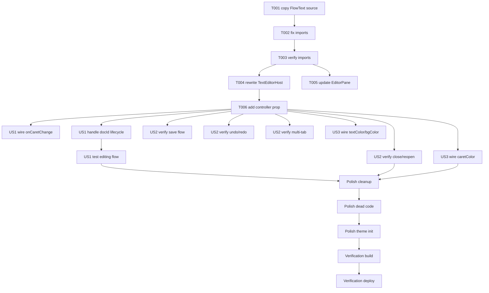

# Tasks: FlowText Integration — 自绘编辑器接入 Weaver

**Input**: Design documents from `spec/flowtext-integration/`
**Prerequisites**: plan.md (required), spec.md (required for user stories)

**Tests**: Not requested (integration feature; verification via build-only per user selection). No TDD test tasks included.

**Organization**: Tasks grouped by phase. Since this is a source-integration task on an existing, already-building project, Phase 1 (Setup) handles FlowText source import, Phase 2 (Foundational) handles the bridge wiring, and Phases 3-5 handle user stories sequentially.

## Format: `[ID] [P?] [Story] Description`

- **[P]**: Can run in parallel (different files, no dependencies)
- **[Story]**: US1–US3 from spec.md
- All paths are under `{PROJECT_ROOT}` (i.e. `/storage/Users/currentUser/Documents/DevEcoStudioProjects/Weaver`)

## Path Conventions

- **Source root**: `entry/src/main/ets/`
- **Editor module**: `entry/src/main/ets/editor/`
- **FlowText source origin**: `/storage/Users/currentUser/Documents/DevEcoStudioProjects/FlowTextTest/flowtext/src/main/ets/editor/` (copy target → `entry/src/main/ets/editor/flowtext/`)
- All paths below are `{PROJECT_ROOT}/<path>`.

---

## Phase 1: Setup (Shared Infrastructure)

**Purpose**: Import FlowText source code into Weaver's source tree as an inline module.

- [X] T001 Copy FlowText source tree from `FlowTextTest/flowtext/src/main/ets/editor/` to `entry/src/main/ets/editor/flowtext/` (all subdirectories: model/, theme/, render/, animation/, interaction/, ime/, plus CanvasTextEditor.ets)
- [X] T002 [P] Update all internal import paths in FlowText files under `entry/src/main/ets/editor/flowtext/` to use relative paths (remove the `flowtext/src/main/ets/editor/` prefix; use `./model/`, `./render/`, etc.)
- [X] T003 Verify FlowText imports are self-consistent by checking that `CanvasTextEditor.ets` can resolve all its imports (`./model/TextDocument`, `./model/EditorTypes`, `./theme/EditorTheme`, `./render/*`, `./animation/*`, `./interaction/*`, `./ime/*`)

**Checkpoint**: FlowText source code is available in Weaver and its internal imports resolve correctly.

---

## Phase 2: Foundational (Blocking Prerequisites)

**Purpose**: Wire FlowText into Weaver's EditorPane → TextEditorHost bridge layer. All user stories depend on this.

**⚠️ CRITICAL**: No user story can work until the bridge is correctly wired.

- [X] T004 Rewrite `entry/src/main/ets/editor/TextEditorHost.ets` to replace `TextArea` + `TextAreaController` with `CanvasTextEditor` + `CanvasTextEditorController`:
  - Import `{ CanvasTextEditor, CanvasTextEditorController }` from `'./flowtext/CanvasTextEditor'`
  - Create `controller: CanvasTextEditorController = new CanvasTextEditorController()` in struct
  - Replace `TextArea({ text: $$this.buffer, ... })` in `build()` with `CanvasTextEditor({ ... })`
  - Remove `@State buffer`, `loadedDocId`, `knownText`, `lastReportedLength`, `pendingCaret` fields (TextArea state management no longer needed)
  - Keep the same `@Prop` interface (`docId/fontSize/lineHeight/textColor/bgColor/caretColor/placeholder`)
  - Keep the same callback interface (`loadText/loadCaret/onTextChange/onCaretChange/onRequestSave`)
  - `docId` changes: instead of `@Watch` + `this.buffer = this.loadText(this.docId)`, use `this.controller.setText(this.loadText(docId))` and `this.controller.setCaretPosition(this.loadCaret(docId))`
  - Forward `onCaretChange` from FlowText's callback (which is `(offset: number) => void`)
  - Forward `onTextChange` from FlowText's callback, ignoring `version` parameter
  - Call `this.controller.focus()` when the editor should gain focus (in `aboutToAppear` and on `docId` change)
  - Call `this.controller.blur()` on blur

- [X] T005 Update `entry/src/main/ets/shell/EditorPane.ets` to pass `CanvasTextEditorController` and handle the `version` parameter in `onTextChange`:
  - Create a `controller: CanvasTextEditorController = new CanvasTextEditorController()` in the `EditorPane` struct
  - Pass it to `TextEditorHost` (add `controller` prop to `TextEditorHost`)
  - In the `onTextChange` callback: change from `(text: string) => { this.app.editor.setContent(text) }` to `(text: string, version: number) => { this.app.editor.setContent(text) }` (wrap to accept version param)
  - Ensure the `docId` prop change triggers controller reload

- [X] T006 Add `controller` prop to `TextEditorHost.ets`'s interface: `controller: CanvasTextEditorController = new CanvasTextEditorController()` and pass it through to `CanvasTextEditor` component

**Checkpoint**: FlowText editor renders in Weaver when opening a document; text input works.

---

## Phase 3: User Story 1 — 正文编辑使用自绘编辑器 (Priority: P1) 🎯 MVP

**Goal**: 用户在 Weaver 中打开/新建文稿，编辑器使用 FlowText 自绘组件，支持精确点击定位光标、平滑光标移动、字符增删动画、换行/回行连贯过渡。

**Independent Test**: 在 Weaver 中新建文稿，输入中英文混合文本，点击不同位置，增删字符，观察编辑体验与 FlowTextTest 一致。

- [X] T007 [US1] Wire `onCaretChange(offset)` from FlowText → Weaver's `EditorStore.setCaret(offset)` in EditorPane's `CanvasTextEditor` callback (ensure caret position tracking works for autosave and cursor restoration)
- [X] T008 [US1] Handle `docId` lifecycle: when `EditorPane` receives a new `docId`, call `controller.setText(loadText(docId))` and `controller.setCaretPosition(loadCaret(docId))` in `aboutToAppear` / on doc change in `entry/src/main/ets/shell/EditorPane.ets`
- [ ] T009 [US1] Test in-editor editing flow: open a document → type text → click to reposition caret → delete text → verify content is reported to `EditorStore` correctly

**Checkpoint**: US1 functional & independently testable (FlowText renders in Weaver, text input/output works).

---

## Phase 4: User Story 2 — 集成不影响已有功能 (Priority: P1)

**Goal**: 所有 Weaver 已有编辑功能（新建/打开/关闭文稿、自动保存、字数统计、撤销/重做、导出/导入）在替换编辑器后正常工作。

**Independent Test**: 逐一执行 Weaver 已有文稿操作流程，对比替换前后行为一致性。

- [ ] T010 [US2] Verify document save flow: when `EditorStore.flushDoc()` is called, the content from FlowText (via `onTextChange`) is correctly persisted via `chapterRepo.updateContent()` in `entry/src/main/ets/store/EditorStore.ets` (no changes needed — already uses `this.content` getter which reads from `activeDoc.draft`)
- [ ] T011 [US2] Verify undo/redo: FlowText's content changes go through `EditorStore.setContent(text)` → `this.remember(doc)` → `undoStack`. The setContent is triggered by `onTextChange`. Verify this chain is intact in `entry/src/main/ets/shell/EditorPane.ets`
- [ ] T012 [US2] Verify multi-tab switching: opening multiple docs, switching between them, each doc's content correctly loads via `controller.setText()` and caret position via `controller.setCaretPosition()` in `entry/src/main/ets/editor/TextEditorHost.ets`
- [ ] T013 [US2] Verify close/reopen: close a tab, reopen — content and cursor restored correctly in `entry/src/main/ets/editor/TextEditorHost.ets`

**Checkpoint**: All existing Weaver editing features work with FlowText backend; no regressions.

---

## Phase 5: User Story 3 — 多稿纸主题适配 (Priority: P2)

**Goal**: FlowText 视觉样式跟随 Weaver 稿纸主题（素白/青笺/茶墨/夜读）和深色模式。

**Independent Test**: 切换四种稿纸主题 + 深色/浅色模式，观察编辑区视觉同步。

- [X] T014 [US3] [P] Wire `textColor` and `bgColor` from Weaver's paper theme → FlowText's canvas rendering in `entry/src/main/ets/editor/TextEditorHost.ets`:
  - CanvasTextEditor currently renders with its own theme colors from `EditorTheme`
  - Need to sync `@Prop textColor` and `@Prop bgColor` into FlowText's `EditorTheme` on prop change
  - Add `@Watch('onThemeChanged')` to `textColor` and `bgColor` props in TextEditorHost
  - In `onThemeChanged()`, update internal theme fields and trigger `this.drawNow()` via the CanvasTextEditor reference

- [X] T015 [US3] Wire `caretColor` from Weaver's brand color → FlowText's caret rendering in `entry/src/main/ets/editor/TextEditorHost.ets` (already a `@Prop`, just ensure the CanvasTextEditor's theme is updated when it changes)

**Checkpoint**: US3 functional — paper theme switching reflects in editor background/text/caret colors.

---

## Phase 6: Polish & Cross-Cutting Concerns

**Purpose**: Clean up, verify import structures, handle edge cases.

- [X] T016 Clean up removed imports in `entry/src/main/ets/editor/TextEditorHost.ets` (remove `TextAreaController`, `focusControl`, `Logger` if no longer needed; add imports for `CanvasTextEditor`, `CanvasTextEditorController`)
- [X] T017 Remove dead code: delete `buffer`, `knownText`, `lastReportedLength`, `pendingCaret`, `loadedDocId` fields and their associated methods (`applyPendingCaret`, `requestFocus`, `handleTextChange`) from `entry/src/main/ets/editor/TextEditorHost.ets`
- [X] T018 Verify the FlowText `EditorTheme` synchronization on `aboutToAppear` — ensure the initial theme values (fontSize, lineHeight, textColor, backgroundColor, caretColor) are applied to FlowText's internal theme

---

## Phase 7: Verification

<!-- verification_scope: build-only -->

**Purpose**: Build and deploy validation (UI verification NOT included — user selected build-only).

- [X] T019 Build project and fix any compilation errors (run `devecocli build` from Weaver project root; iterate fix → build until success)
- [ ] T020 Deploy application to device (run `devecocli run --skip-build`; if no device, confirm HAP built and note manual device test steps) — ⚠️ No device available; HAP built successfully at `/storage/Users/currentUser/Documents/DevEcoStudioProjects/Weaver/entry/build/default/outputs/default/entry-default-unsigned.hap`

---

## 📊 Dependency Graph

## ⚡ Parallel Execution Guide

| Phase | Tasks | Required Files | Execution Notes |
|-------|-------|----------------|-----------------|
| Setup | T001 | new files in `editor/flowtext/` | Sequential (copy then fix) |
| Setup | T002–T003 | `editor/flowtext/**/*.ets` | Sequential (fix imports then verify) |
| Foundational | T004 | `editor/TextEditorHost.ets` | Core rewrite — serialize |
| Foundational | T005 | `shell/EditorPane.ets` | Can run parallel with T006 |
| Foundational | T006 | `editor/TextEditorHost.ets` | After T004 (same file) |
| US1 | T007–T009 | `shell/EditorPane.ets`, `editor/TextEditorHost.ets` | Sequential |
| US2 | T010–T013 | `editor/TextEditorHost.ets`, `store/EditorStore.ets` | Sequential (verification tasks) |
| US3 | T014–T015 | `editor/TextEditorHost.ets` | Parallel within US3 |
| Polish | T016–T018 | `editor/TextEditorHost.ets` | Sequential |
| Verification | T019–T020 | — | Sequential build → deploy |

## Summary Report

- **Total tasks**: 20 (T001–T020)
- **By phase**: Setup 3 · Foundational 3 · US1 3 · US2 4 · US3 2 · Polish 3 · Verification 2
- **By story**: US1=3, US2=4, US3=2 (story tasks carry [USx] label; Setup/Foundational/Polish/Verification carry none)
- **Parallel opportunities**: T002 (import fix) can run after T001; T005 (EditorPane) can run in parallel with T004/T006 (TextEditorHost) since they're different files; T014/T015 are parallel within US3
- **Independent test criteria**: Each US independently testable on device per spec.md (editor rendering US1, functional preservation US2, theme sync US3)
- **Suggested MVP scope**: T001–T009 (Setup + Foundational + US1) completes the core integration — FlowText renders and accepts input in Weaver
