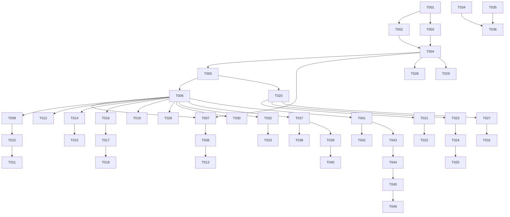

# Tasks: FlowText Sole Editor — 以全自绘编辑器作为唯一正文编辑面

**Input**: Design documents from `spec/flowtext-sole-editor/`
**Prerequisites**: plan.md (required), spec.md (required for user stories)

**Tests**: 本特性规格未明确要求测试任务，故不生成测试任务（遵循"Tests are OPTIONAL"）。

**Organization**: 任务按用户故事分组，每个故事可独立实现、独立验证、增量交付。

## Format: `[ID] [P?] [Story] Description`

- **[P]**: 可并行（不同文件、无未完成依赖）
- **[Story]**: 所属用户故事（US1–US7）
- 每个任务以精确文件路径结尾

## Path Conventions

- 仓库根：`/storage/Users/currentUser/Documents/DevEcoStudioProjects/Weaver/`
- 下列路径为仓库相对路径（单 entry 模块）。

---

## Phase 1: Setup (Shared Infrastructure)

**Purpose**: 建立构建/验证基线与共享值类型，不改变行为。

- [X] T001 建立构建与真机验证基线：运行 `devecocli build` 与 `devecocli run --skip-build`，记录当前构建结果与设备可用性（workdir: `/storage/Users/currentUser/Documents/DevEcoStudioProjects/Weaver`）
- [X] T002 [P] 规范诊断与日志输出（复用 `DIAG_ENABLED`）：为滚动/居中/动画/格式预留量化输出点，`entry/src/main/ets/editor/flowtext/CanvasTextEditor.ets`
- [X] T003 新增共享值类型 `ScrollPolicy`（NORMAL/CENTER）与 `StyleKind`（BOLD/ITALIC/HEADING_1..3/BODY），`entry/src/main/ets/editor/flowtext/model/EditorTypes.ets`

---

## Phase 2: Foundational (Blocking Prerequisites)

**Purpose**: 打通"应用层 ↔ 自绘编辑器"的契约与装配；**阻塞所有用户故事**。

**⚠️ CRITICAL**: 本阶段完成前不得开始任何用户故事。

- [X] T004 扩展 `TextEditorHost` 对外契约：新增可选输入 `typewriter`、`scrollPolicy`、`loadFormat`，新增可选输出 `onSelectionChange`、`onFormatChange`、`onScrollState`（保持既有签名不变），`entry/src/main/ets/editor/TextEditorHost.ets`
- [X] T005 扩展 `CanvasTextEditor` 组件契约：新增 props `typewriter`/`scrollPolicy`/`runs` 与回调 `onSelectionChange`/`onFormatChange`/`onScrollState`，`entry/src/main/ets/editor/flowtext/CanvasTextEditor.ets`
- [X] T006 更新 `EditorPane` 装配：改为单一渲染路径的调用形态，透传新 props 并绑定新回调（此时仍可保留原生分支的编译通过），`entry/src/main/ets/shell/EditorPane.ets`

**Checkpoint**: 契约与装配就绪，用户故事可开始。

---

## Phase 3: User Story 1 - 打字机写作体验（居中跟随 + 字符动画）(Priority: P1) 🎯 MVP

**Goal**: 开启打字机后当前段保持垂直居中并随输入跟随；输入/删除具备字符级动画。

**Independent Test**: 新建文稿并开启打字机，连续输入/删除中英文本并多次折行，观察居中偏差与动画连续性、已有文本是否稳定。

- [X] T007 [US1] 在 `CanvasTextEditor` 实现程序化滚动与 `ensureCaretVisible(policy)`（`scrollY` 使其满足 NORMAL/CENTER 策略），`entry/src/main/ets/editor/flowtext/CanvasTextEditor.ets`
- [X] T008 [US1] 实现 CENTER 居中跟随：输入/光标变化时使当前段中心对齐视口中心，`entry/src/main/ets/editor/flowtext/CanvasTextEditor.ets`
- [X] T009 [US1] `TextEditorHost` 接收并驱动 `typewriter`/`scrollPolicy`（默认关、NORMAL），`entry/src/main/ets/editor/TextEditorHost.ets`
- [X] T010 [US1] 接线字符入场/消退动画：将 `GlyphAnimator.createEditAnimations` 接入编辑提交路径并启用 `drawAnimatedGlyph`，`entry/src/main/ets/editor/flowtext/animation/GlyphAnimator.ets`
- [X] T011 [US1] 补齐行位移过渡动画（换行/回行时既有行的滑动过渡），`entry/src/main/ets/editor/flowtext/animation/GlyphAnimator.ets`
- [X] T012 [US1] 提供打字机开关入口（默认关）：`UiStore.typewriter` 与设置页开关，`entry/src/main/ets/store/UiStore.ets`
- [X] T013 [US1] 输出居中偏差与动画帧的量化诊断日志，`entry/src/main/ets/editor/flowtext/CanvasTextEditor.ets`

**Checkpoint**: US1 可独立验证（打字机居中 + 动画）。

---

## Phase 4: User Story 2 - 编辑正确性（IME / 光标 / 选区 / 命中）(Priority: P1)

**Goal**: 组合输入/预上屏/提交流程正确；选区可拖手柄；命中精确。

**Independent Test**: 中英混合 + emoji 输入 200 字符，验证内容/光标/选区/命中的一致性。

- [X] T014 [US2] 接通 IME 预上屏：订阅预上屏回调并驱动 `PreviewTextManager.update`，`entry/src/main/ets/editor/flowtext/ime/ImeBridge.ets`
- [X] T015 [US2] 接通预上屏提交：在 IME 提交时机调用 `PreviewTextManager.commit`，`entry/src/main/ets/editor/flowtext/CanvasTextEditor.ets`
- [X] T016 [US2] 选区手柄模型与锚点（起点/终点、grapheme 对齐），`entry/src/main/ets/editor/flowtext/interaction/SelectionManager.ets`
- [X] T017 [US2] 选区手柄绘制（手柄形状与命中区域），`entry/src/main/ets/editor/flowtext/render/GlyphRenderer.ets`
- [X] T018 [US2] 手柄命中与拖动处理（长按/拖动手柄更新选区），`entry/src/main/ets/editor/flowtext/interaction/EditorGesture.ets`
- [X] T019 [US2] 选区变化回传：`onSelectionChange` 经宿主上抛，供工具栏态使用，`entry/src/main/ets/editor/TextEditorHost.ets`

**Checkpoint**: US2 可独立验证（正确性）。

---

## Phase 5: User Story 3 - 正文富文本：行内格式（粗/斜/标题）(Priority: P1)

**Goal**: 可对选区施加/取消行内格式与段落标题，格式可保存与撤销。

**Independent Test**: 设置粗/斜/标题后保存重开一致；对格式执行撤销重做正确。

- [X] T020 [US3] 引入格式标注模型（非重叠、按偏移排序的 runs）与不变式维护，`entry/src/main/ets/editor/flowtext/model/TextDocument.ets`
- [X] T021 [US3] 布局引擎按 run 构造差异化文本样式（字重/斜体/标题字号），`entry/src/main/ets/editor/flowtext/render/TextLayoutEngine.ets`
- [X] T022 [US3] 渲染层呈现格式（按 run 绘制），`entry/src/main/ets/editor/flowtext/render/GlyphRenderer.ets`
- [X] T023 [US3] 格式命令 `toggleInlineStyle` / `toggleParagraphStyle`（作用于当前选区/段落），`entry/src/main/ets/editor/flowtext/CanvasTextEditor.ets`
- [X] T024 [US3] 格式参与撤销/重做与回灌（历史快照需覆盖格式），`entry/src/main/ets/store/EditorStore.ets`
- [X] T025 [US3] 格式持久化落库（格式边车随文稿保存/打开，旧数据缺省纯文本），`entry/src/main/ets/store/StoreModels.ets`
- [X] T026 [US3] 格式工具栏入口（粗/斜/标题的施加与取消 UI），`entry/src/main/ets/shell/EditorPane.ets`
- [X] T027 [US3] 导出服务对行内格式的处理（按既有导出策略，避免格式丢失或串入正文），`entry/src/main/ets/utils/ExportService.ets`

**Checkpoint**: US3 可独立验证（格式设置/保存/撤销）。

---

## Phase 6: User Story 4 - 既有写作功能零退化 (Priority: P1)

**Goal**: 替换为唯一编辑面后，既有功能不退化。

**Independent Test**: 逐条执行既有编辑操作流程，对比行为一致性。

- [X] T028 [US4] 修复 `onRequestSave` 未触发问题（失焦/切走时正确请求保存），`entry/src/main/ets/editor/TextEditorHost.ets`
- [X] T029 [US4] 切换文稿/切后台/回灌时正文与光标准确恢复（含格式回灌），`entry/src/main/ets/editor/TextEditorHost.ets`
- [X] T030 [US4] 视觉参数变更（主题/深色/字号/行距）立即重排重绘，`entry/src/main/ets/editor/flowtext/theme/EditorTheme.ets`
- [X] T031 [US4] 导入/导出/一键排版/查找替换与新格式的兼容回归与修复，`entry/src/main/ets/utils/ExportService.ets`

**Checkpoint**: US4 可独立验证（回归）。

---

## Phase 7: User Story 5 - 滚动与专注联动 (Priority: P2)

**Goal**: 滚动正文自动隐藏顶栏/工具条，停止或反向恢复。

**Independent Test**: 长文上下滚动，观察 chrome 显隐。

- [X] T032 [US5] 滚动状态上报：自绘编辑器产生滚动方向/状态并经宿主上抛，`entry/src/main/ets/editor/flowtext/CanvasTextEditor.ets`
- [X] T033 [US5] 复用 `UiStore.immersive` 实现滚动隐藏/恢复顶栏与工具条，`entry/src/main/ets/shell/EditorPane.ets`

**Checkpoint**: US5 可独立验证。

---

## Phase 8: User Story 6 - 长文可用性与性能（≤5 万字）(Priority: P2)

**Goal**: 5 万字下输入/滚动流畅。

**Independent Test**: 在 5 万字长文上连续输入、快速滚动、随机点击，测量响应与帧率。

- [X] T034 [US6] 视口限域渲染（仅绘制可见区段），`entry/src/main/ets/editor/flowtext/render/GlyphRenderer.ets`
- [X] T035 [US6] 增量布局与失效范围收敛（含格式版本键），`entry/src/main/ets/editor/flowtext/render/LayoutCache.ets`
- [X] T036 [US6] 5 万字性能测量与调优（输入延迟/滚动帧率，诊断量化），`entry/src/main/ets/editor/flowtext/CanvasTextEditor.ets`

**Checkpoint**: US6 可独立验证（性能门限）。

---

## Phase 9: User Story 7 - 单引擎收敛 (Priority: P3)

**Goal**: 仅保留一条编辑实现路径，移除原生引擎与切换入口。

**Independent Test**: 设置页无"编辑引擎"项；代码库仅一条可用编辑路径。

- [X] T037 [US7] 移除 `EditorPane` 中的原生引擎渲染分支，`entry/src/main/ets/shell/EditorPane.ets`
- [X] T038 [US7] 退役并删除 `RichTextEditorHost.ets` 及其全部引用，`entry/src/main/ets/editor/RichTextEditorHost.ets`
- [X] T039 [US7] 移除 `EditorEngine` 枚举与 `UiStore.editorEngine`/`setEditorEngine`/prefs `engine` 键，`entry/src/main/ets/constants/DesignTokens.ets`
- [X] T040 [US7] 移除设置页"正文编辑引擎"切换项，`entry/src/main/ets/pages/dest/SettingsDest.ets`

**Checkpoint**: 全部用户故事完成且单引擎收敛。

---

## Phase 10: Polish & Cross-Cutting Concerns

**Purpose**: 清理与一致性收尾。

- [X] T041 清理 `flowtext` 死代码与未用 import（如未使用字段/空调用点），`entry/src/main/ets/editor/flowtext/`
- [X] T042 [P] 更新文档（特性说明/迁移说明）于 `spec/flowtext-sole-editor/` 或项目 README
- [X] T043 [P] 命名与诊断开关一致性检查（`DIAG_ENABLED` 与日志标签统一），`entry/src/main/ets/editor/flowtext/CanvasTextEditor.ets`

---

## Phase 11: Verification

<!-- verification_scope: build+ui -->

**Purpose**: 构建、部署并（因选定 build+ui）进行 UI 验证

- [X] T044 Build project and fix any compilation errors（运行 `devecocli build`，迭代修复直至成功；workdir: `/storage/Users/currentUser/Documents/DevEcoStudioProjects/Weaver`）
- [X] T045 Deploy application to device（运行 `devecocli run --skip-build`）
- [X] T046 Run UI verification against deployed application（invoke verify_ui，逐用户故事覆盖打字机居中/动画/正确性/格式/滚动/性能/收敛）

---

## Dependencies & Execution Order

### Phase Dependencies

- **Setup (Phase 1)**: 无依赖，可立即开始
- **Foundational (Phase 2)**: 依赖 Setup 完成，**阻塞所有用户故事**
- **User Stories (Phase 3+)**: 均依赖 Foundational 完成；可并行，或按 P1 → P2 → P3 顺序
- **Polish**: 依赖所需用户故事完成
- **Verification**: 依赖全部实现任务完成

### User Story Dependencies

- **US1 (P1)**: Foundational 后可开始，无跨故事依赖
- **US2 (P1)**: Foundational 后可开始，独立可测
- **US3 (P1)**: Foundational 后可开始；与 US1/US2 无强依赖（共用契约）
- **US4 (P1)**: Foundational 后可开始
- **US5 (P2)**: 依赖 US1 的滚动能力（T032 之后）
- **US6 (P2)**: 依赖格式渲染与布局（T034/T035 汇于 T036）
- **US7 (P3)**: 应在 US1–US6 完成后进行（收敛）

### Within Each User Story

- 模型先于服务/渲染
- 核心实现先于集成
- 故事完成后再进入下一优先级

### Parallel Opportunities

- Setup 中 [P] 任务可并行
- Foundational 完成后，各用户故事可并行（若人力允许）
- 同一故事内不同文件的任务可并行

---

## 📊 Dependency Graph



## ⚡ Parallel Execution Guide

| Phase | Tasks | Required Files | Execution Notes |
|-------|-------|----------------|-----------------|
| Setup | T002, T003 | CanvasTextEditor.ets；EditorTypes.ets | 不同文件，可并行 |
| Foundational | T004, T005, T006 | TextEditorHost.ets；CanvasTextEditor.ets；EditorPane.ets | 串行为主（契约先行） |
| US1 | T007, T012 | CanvasTextEditor.ets；UiStore.ets | T012 可与 T007 并行 |
| US2 | T014, T016 | ImeBridge.ets；SelectionManager.ets | 可并行（不同文件） |
| US3 | T020, T026 | TextDocument.ets；EditorPane.ets | 可并行 |
| US4 | T028, T030 | TextEditorHost.ets；EditorTheme.ets | 可并行 |
| US5 | T032 → T033 | CanvasTextEditor.ets → EditorPane.ets | 串行 |
| US6 | T034, T035 | GlyphRenderer.ets；LayoutCache.ets | 可并行，汇于 T036 |
| US7 | T037–T040 | EditorPane.ets / RichTextEditorHost.ets / DesignTokens.ets / SettingsDest.ets | 串行为主 |
| Polish | T042, T043 | 文档；CanvasTextEditor.ets | 可并行 |
| Verification | T044 → T045 → T046 | 全项目 | 严格串行 |

---

## Parallel Example: User Story 1

```bash
# 同一故事内可并行（不同文件）：
Task: "T007 程序化滚动 ensureCaretVisible in CanvasTextEditor.ets"
Task: "T012 打字机开关入口 in UiStore.ets"
```

---

## Implementation Strategy

### MVP First（US1）

1. 完成 Phase 1 Setup + Phase 2 Foundational（阻塞项）。
2. 完成 Phase 3 US1（打字机居中 + 字符动画）。
3. **停止并独立验证 US1**（居中偏差/动画连续性/文本稳定）。
4. 可先行演示。

### Incremental Delivery

1. Setup + Foundational → 基座就绪。
2. + US1 → 独立验证 → 交付 MVP。
3. + US2 → 独立验证（正确性）。
4. + US3 → 独立验证（格式）。
5. + US4/US5/US6/US7 → 逐项验证 → 最终单引擎收敛。
6. 每步均不破坏前序能力。

### 分期映射（对齐 plan R11）

- **期 A**：Setup/Foundational + US1 + US2 + US4 + US5（可日用正确性 + 招牌打字机/动画 + 回归）
- **期 B**：US3（行内格式）
- **期 C**：US6 + US7（性能打磨 + 单引擎收敛）

---

## Notes

- [P] = 不同文件、无未完成依赖。
- [Story] 标签用于追溯用户故事。
- 每个用户故事应可独立完成与验证。
- 每完成一个任务或逻辑组后提交变更。
- 在每个 Checkpoint 停下可独立验证。
- 避免：含糊任务、同文件冲突、破坏独立性的跨故事依赖。

---

## Summary Report

- **总任务数**: 46（T001–T046）
- **按阶段**: Setup 3｜Foundational 3｜US1 7｜US2 6｜US3 8｜US4 4｜US5 2｜US6 3｜US7 4｜Polish 3｜Verification 3
- **并行机会**: Setup(T002/T003)、US2(T014/T016)、US3(T020/T026)、US4(T028/T030)、US6(T034/T035)、Polish(T042/T043)
- **独立验证标准**: 见各故事 "Independent Test"；US1 居中偏差 ≤ 视口高 ±10%；US2 200 字一致性 100%；US3 格式保存重开一致率 100%；US6 输入 <50ms / 滚动 ≥50fps；US7 设置无引擎项且单路径。
- **建议 MVP**: Phase 1 + Phase 2 + **US1**（打字机居中 + 字符动画），即可演示"原生做不到的写作体验"。
- **验证范围**: `build+ui`（含 UI 验证）。


