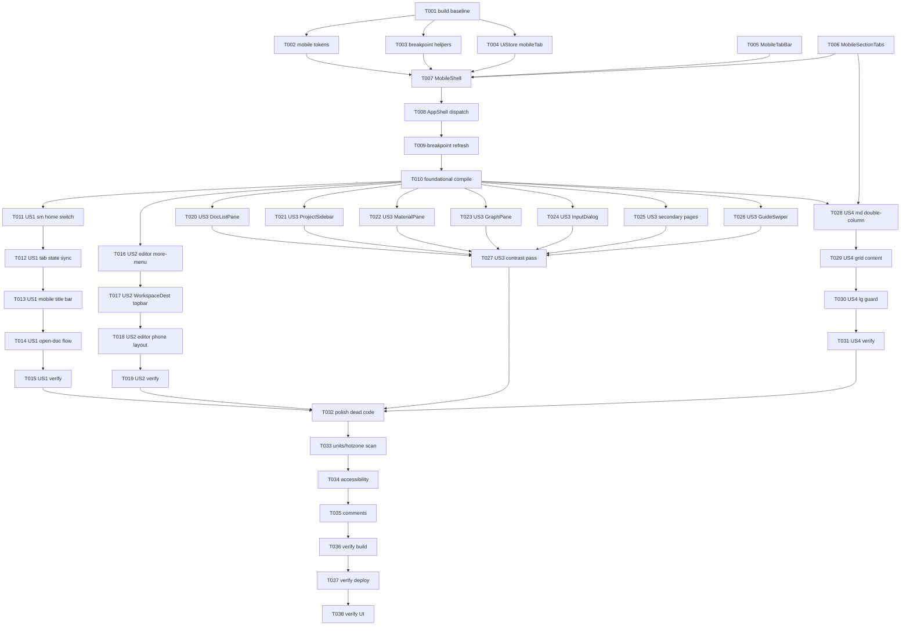

# Tasks: 手机端 UI 重构 —— 断点栅格驱动的移动端体验重做

**Input**: Design documents from `spec/mobile-ui-refactor/`
**Prerequisites**: plan.md (required), spec.md (required for user stories)

**Tests**: Not requested. 本特性为 UI 重构，验证采用构建 + 实机截图（用户选择 `build+ui`）。不生成 TDD 测试任务。

**Organization**: 任务按用户故事分组，保证每个故事可独立实现与独立验证。

## Format: `[ID] [P?] [Story] Description`

- **[P]**: 可并行（不同文件、无未完成依赖）
- **[Story]**: 所属用户故事（US1–US4，来自 spec.md）
- 所有路径为 `{PROJECT_ROOT}/` 下相对路径（`PROJECT_ROOT` = `/storage/Users/currentUser/Documents/DevEcoStudioProjects/Weaver`）

## Path Conventions

- **源码根**: `entry/src/main/ets/`
- **外壳**: `entry/src/main/ets/shell/`
- **令牌**: `entry/src/main/ets/constants/`
- **UI 状态**: `entry/src/main/ets/store/`
- **二级页**: `entry/src/main/ets/pages/dest/`

---

## Phase 1: Setup (Shared Infrastructure)

**Purpose**: 建立移动端共享令牌、断点档位辅助与 UI 状态字段，并确认改动前构建基线。

- [X] T001 Run `devecocli build` from project root to establish a clean pre-change build baseline (record ERROR/WARN counts) — workdir `{PROJECT_ROOT}`
- [X] T002 [P] Add mobile layout tokens (title bar height, bottom tab bar height ≥56vp, page margins 24/16vp, card radius, minimum touch target 48/40vp) to `entry/src/main/ets/constants/DesignTokens.ets`
- [X] T003 [P] Add layout-tier helpers (`isMobile` = SM, `isMedium` = MD, `isWide` = LG) to `entry/src/main/ets/utils/BreakPoint.ets`
- [X] T004 [P] Add `MobileTab` enum (PROJECT/DOCS/MATERIALS/GRAPH) + `mobileTab` trace state to `entry/src/main/ets/store/UiStore.ets`

**Checkpoint**: 令牌、断点辅助与 UI 状态就绪，基线构建通过。

---

## Phase 2: Foundational (Blocking Prerequisites)

**Purpose**: 断点分发骨架与手机端外壳（含路由），是所有用户故事的前置。

**⚠️ CRITICAL**: 用户故事必须在本阶段完成后才能开始。

- [X] T005 [P] Create `entry/src/main/ets/shell/MobileTabBar.ets` — 底部页签栏组件（输入 items/selected/darkMode，输出 onSelect；页签热区 ≥ 底栏高度；选中态色/图标区分；含 accessibilityText）
- [X] T006 [P] Create `entry/src/main/ets/shell/MobileSectionTabs.ets` — md 内容区顶部分段页签（文稿/素材/关系图；输入 selected/darkMode，输出 onSelect）
- [X] T007 Create `entry/src/main/ets/shell/MobileShell.ets` — 断点感知外壳：`sm` 单列布局、`md` 侧栏+内容双栏；内嵌 `Navigation(nav)`（显式 Stack、隐藏标题/工具条）与 `navDestination` 页映射（workspace/settings/character/world/inspiration）；复用现有面板组件（depends: T002–T006）
- [X] T008 Modify `entry/src/main/ets/shell/AppShell.ets` — 增加断点分发：`breakPoint===LG` 走现有 `mainLayout()`（保持不动），`SM/MD` 走 `MobileShell`（depends: T007）
- [X] T009 Modify `entry/src/main/ets/shell/AppShell.ets` — 断点刷新时同步 `app.ui.breakPoint`，按档位重置 `mobileTab`（进入 sm 默认文稿）与 `showSidebar`（md/lg 显示），仅做 UI 刷新（depends: T008）
- [X] T010 Verify Foundational compiles: run `check_ets_files` on new/changed shell files and `devecocli build` from `{PROJECT_ROOT}`; confirm no new ERROR and `lg` branch code path unchanged (depends: T008, T009)

**Checkpoint**: 断点分发与手机端外壳可编译运行；`lg` 路径保持原样。

---

## Phase 3: User Story 1 - 手机端底部页签主导航 (Priority: P1) 🎯 MVP

**Goal**: `sm` 下主界面为单列内容 + 底部页签（项目/文稿/素材/关系图），移除旧堆叠文字功能条，项目/文库入口清晰可达。

**Independent Test**: 手机断点冷启动，底栏存在且可切换四个板块；点开文稿进入编辑页并可返回；无横向溢出文字条。

- [X] T011 [US1] Implement `sm` home content switching in `entry/src/main/ets/shell/MobileShell.ets` — 按 `app.ui.mobileTab` 渲染 项目(ProjectSidebar)/文稿(DocListPane)/素材(MaterialPane)/关系图(GraphPane)（depends: T007）
- [X] T012 [US1] Wire `MobileTabBar` selection to `app.ui.mobileTab` and sync `app.ui.view` for 素材/关系图 sections in `entry/src/main/ets/shell/MobileShell.ets`
- [X] T013 [US1] Add mobile title bar (≤ 标题 + 2 个操作入口) to `entry/src/main/ets/shell/MobileShell.ets`; ensure legacy `appBar()` is not rendered in `sm/md`
- [X] T014 [US1] Implement open-doc flow in `entry/src/main/ets/shell/MobileShell.ets`: push `workspace` route to cover the home; on back preserve selected tab
- [X] T015 [US1] Verify US1 navigation flow via `devecocli build` + `check_ets_files` on `MobileShell.ets` (UI screenshot deferred to Verification phase)

**Checkpoint**: US1 独立可用（底栏导航 + 四板块切换 + 项目入口 + 打开文稿返回）。

---

## Phase 4: User Story 2 - 沉浸式单列写作编辑器 (Priority: P1)

**Goal**: `sm` 打开文稿后为单列沉浸编辑，次要操作收纳进"更多"菜单，保存态/字数弱化；核心编辑功能不退化。

**Independent Test**: 打开文稿可输入中英文、自动保存更新、字数更新；切换 TXT/MD、收藏、灵感、撤销/重做可从"更多"完成；返回后正文与光标保留。

- [X] T016 [US2] Modify `entry/src/main/ets/shell/EditorPane.ets` — `sm` 隐藏旧横向工具条，新增"更多"操作菜单（格式 TXT/MD、收藏、灵感、撤销/重做，复用 promptAction.showActionMenu）；`lg` 保留旧工具条
- [X] T017 [US2] Modify `entry/src/main/ets/shell/WorkspaceDest.ets` — 顶部页签按断点呈现；`sm` 不重复渲染 文稿/素材/关系图（由底栏承担）；`lg` 不变
- [X] T018 [US2] Adjust `entry/src/main/ets/shell/EditorPane.ets` empty state / save hint / word count for phone layout (weakened presentation, adequate hot zone)
- [X] T019 [US2] Verify editor flow preserved: `devecocli build` + confirm no changes to `store/EditorStore.ets`, `editor/TextEditorHost.ets`, `editor/flowtext/**`

**Checkpoint**: US2 独立可用；现有编辑/保存/撤销/导出一律不退化。

---

## Phase 5: User Story 3 - 手机端列表 / 素材 / 二级页统一视觉 (Priority: P2)

**Goal**: 联系人列表、项目/文库、素材、二级详情、设置、引导页在手机端观感统一（间距/圆角/热区/层级/明暗对比）。

**Independent Test**: 逐页浏览手机端各页面，间距/字号/热区/圆角一致，深色与浅色均无硬编码浅色块，无溢出。

- [X] T020 [P] [US3] Polish list row spacing/hot zone/typography in `entry/src/main/ets/shell/DocListPane.ets` (keep `@Param`/`@Event` contract)
- [X] T021 [P] [US3] Polish spacing/hot zone in `entry/src/main/ets/shell/ProjectSidebar.ets`
- [X] T022 [P] [US3] Polish margins/cards/hot zone in `entry/src/main/ets/shell/MaterialPane.ets`
- [X] T023 [P] [US3] Polish header/legend spacing in `entry/src/main/ets/shell/GraphPane.ets`
- [X] T024 [US3] Polish width/radius/button hot zone in `entry/src/main/ets/shell/InputDialog.ets`
- [X] T025 [US3] Unify secondary pages title bar/hot zone in `entry/src/main/ets/pages/dest/SettingsDest.ets`, `entry/src/main/ets/pages/dest/CharacterDetailDest.ets`, `entry/src/main/ets/pages/dest/WorldSettingDetailDest.ets`, `entry/src/main/ets/pages/dest/InspirationCreateDest.ets`
- [X] T026 [US3] Polish margins/button hot zone in `entry/src/main/ets/pages/GuideSwiperPage.ets`
- [X] T027 [US3] Dark/light contrast pass: ensure body text ≥4.5:1, icon/title ≥3:1, no hardcoded light blocks in dark mode — adjust `entry/src/main/ets/constants/DesignTokens.ets` + affected components

**Checkpoint**: US3 独立可用；手机端主要页面视觉统一且明暗对比达标。

---

## Phase 6: User Story 4 - 断点 / 栅格驱动的响应式布局切换 (Priority: P2)

**Goal**: `sm↔md` 跨断点正确切换（单列↔双栏）；内容区用官方栅格组织列数与正文缩进；`lg` 零回归。

**Independent Test**: 缩放/旋转跨断点，sm→md 切为侧栏+内容双栏、md→sm 恢复单列；`lg` 与改造前一致；宽内容区有缩进留白。

- [X] T028 [US4] Implement `md` double-column in `entry/src/main/ets/shell/MobileShell.ets` — `SideBarContainer(Embed)` 左侧 ProjectSidebar + 右侧内容（含 `MobileSectionTabs`）（depends: T006, T007）
- [X] T029 [US4] Introduce `GridRow/GridCol` for content (list columns and editor body indent) in relevant panes — ensure `span/offset` are integers and no `span === columns` misuse (files: `entry/src/main/ets/shell/DocListPane.ets`, `entry/src/main/ets/shell/MaterialPane.ets`, `entry/src/main/ets/shell/EditorPane.ets`)
- [X] T030 [US4] Add `lg` zero-regression guard: confirm `entry/src/main/ets/shell/AppShell.ets` lg branch is unchanged and document a before/after comparison checklist (screenshots captured in Verification)
- [X] T031 [US4] Verify sm↔md↔lg switching via `devecocli build` + `check_ets_files`; confirm no layout branch uses device type/direction/fold state (UI screenshot deferred to Verification)

**Checkpoint**: US4 独立可用；三档布局切换正确，`lg` 不受影响。

---

## Phase 7: Polish & Cross-Cutting Concerns

**Purpose**: 清理与横切质量收口。

- [X] T032 [P] Remove dead code / unused imports introduced by the refactor across changed shell & page files
- [X] T033 [P] Unit & hot-zone compliance scan across changed files: `width/height` use vp, font sizes use fp, primary touch targets ≥40vp (prefer 48vp)
- [X] T034 Add `accessibilityText`/`accessibilityRole` for bottom tabs and primary actions in `entry/src/main/ets/shell/MobileTabBar.ets` and `entry/src/main/ets/shell/MobileShell.ets`
- [X] T035 Update header comments in changed shell files (`MobileShell.ets` / `MobileTabBar.ets` / `MobileSectionTabs.ets` / `AppShell.ets`) to reflect the new breakpoint-driven architecture

---

## Phase 8: Verification

<!-- verification_scope: build+ui -->

**Purpose**: 构建、部署并逐故事 UI 验证（用户选择 `build+ui`）。

- [X] T036 Build project and fix any compilation errors (run `devecocli build` from `{PROJECT_ROOT}`; iterate fix → build until success)
- [X] T037 Deploy application to device (run `devecocli run --skip-build`; if no device, report and provide manual test steps)
- [ ] T038 Run UI verification against deployed application — per-story screenshots (US1 底部页签导航、US2 沉浸式编辑器、US3 视觉统一、US4 sm↔md 切换 + lg 零回归), with human review of each screenshot
  - 进行情况：US1/US2/US3 已实机截图复核通过（US2 修复了一个 showActionMenu 空 color 导致的运行时崩溃）；US4（sm↔md↔lg 跨断点切换）未执行——`verify_ui` 后端不可用（Connect server failed），且本机无旋转/窗口尺寸调整能力（devecocli 无旋转命令，禁止使用 hdc），无法在手机竖屏下把窗口宽度推过 600vp / 840vp。`lg` 零回归仅完成静态代码复核（AppShell `mainLayout` 在 LG 走 `appBar()+wideBody()`，结构未变）。

---

## 📊 Dependency Graph



## ⚡ Parallel Execution Guide

| Phase | Tasks | Required Files | Execution Notes |
|-------|-------|----------------|-----------------|
| Setup | T001 | — | 串行：先取构建基线 |
| Setup | T002–T004 | `constants/DesignTokens.ets`, `utils/BreakPoint.ets`, `store/UiStore.ets` | 三文件互不依赖，可并行 |
| Foundational | T005–T006 | `shell/MobileTabBar.ets`, `shell/MobileSectionTabs.ets` | 新文件，可并行 |
| Foundational | T007 | `shell/MobileShell.ets` | 依赖 T002–T006，串行 |
| Foundational | T008–T009 | `shell/AppShell.ets` | 同文件，串行 |
| Foundational | T010 | — | 构建校验 |
| US1 | T011–T014 | `shell/MobileShell.ets` | 同文件，串行 |
| US1 | T015 | — | 构建校验 |
| US2 | T016–T018 | `shell/EditorPane.ets`, `shell/WorkspaceDest.ets` | T017 与 T016 不同文件，可在 T016 后并行 |
| US2 | T019 | — | 构建校验，确认编辑层未改 |
| US3 | T020–T026 | `shell/*`, `pages/dest/*`, `pages/GuideSwiperPage.ets` | 不同文件，可整体并行 |
| US3 | T027 | `constants/DesignTokens.ets` + 受影响组件 | 等 T020–T026 完成后收口 |
| US4 | T028 | `shell/MobileShell.ets` | 依赖 T006/T007 |
| US4 | T029–T030 | `shell/DocListPane.ets`, `shell/MaterialPane.ets`, `shell/EditorPane.ets`, `shell/AppShell.ets` | T029/T030 后串行 |
| US4 | T031 | — | 构建校验 |
| Polish | T032–T035 | changed shell & page files | T032/T033 可并行；T034/T035 依次 |
| Verification | T036–T038 | — | 串行：构建 → 部署 → UI 验证 |

## Summary Report

- **Total tasks**: 38 (T001–T038)
- **By phase**: Setup 4 · Foundational 6 · US1 5 · US2 4 · US3 8 · US4 4 · Polish 4 · Verification 3
- **By story**: US1=5, US2=4, US3=8, US4=4（故事任务带 `[USx]`；Setup/Foundational/Polish/Verification 不带）
- **Parallel opportunities**: T002/T003/T004；T005/T006；US3 的 T020–T026；Polish 的 T032/T033
- **Independent test criteria**: US1 底栏导航独立验证 · US2 编辑器流程独立验证 · US3 视觉一致性独立验证 · US4 断点切换与 `lg` 零回归独立验证
- **Suggested MVP scope**: T001–T015（Setup + Foundational + US1）完成"手机端底部页签导航"核心骨架
- **Verification scope**: `build+ui`（构建 + 部署 + 逐故事截图人工复核）

---

## Dependencies & Execution Order

### Phase Dependencies

- **Setup (Phase 1)**: 无依赖，可立即开始（T001 先取构建基线）
- **Foundational (Phase 2)**: 依赖 Setup 完成 —— **阻塞所有用户故事**
- **User Stories (Phase 3–6)**: 均依赖 Foundational 完成；完成骨架后可并行（若人力允许），或按优先级 P1 → P2 串行
- **Polish (Phase 7)**: 依赖全部目标用户故事完成
- **Verification (Phase 8)**: 依赖 Polish 完成

### User Story Dependencies

- **US1 (P1)**: Foundational 后可开始；无其他故事依赖（MVP）
- **US2 (P1)**: Foundational 后可开始；编辑器推送复用 US1 的 `MobileShell` 路由宿主，建议在 US1 之后进行
- **US3 (P2)**: Foundational 后可独立开始（不同文件，互不依赖）
- **US4 (P2)**: Foundational 后可开始；`md` 双栏分支复用 US1 的 `MobileShell`，建议在 US1 之后进行

### Within Each User Story

- 状态/令牌 → 组件 → 集成（本 UI 特性无 models/services 顺序）
- 核心实现先于跨面板集成
- 每个故事完成并通过校验后再进入下一优先级

### Parallel Opportunities

- Setup 中 T002/T003/T004 可并行
- Foundational 中 T005/T006 可并行
- US3 的 T020–T026 可整体并行（不同文件）
- Polish 的 T032/T033 可并行

---

## Parallel Example

```text
# US3 可并行铺开（不同文件，无相互依赖）：
Task: "T020 Polish DocListPane.ets"
Task: "T021 Polish ProjectSidebar.ets"
Task: "T022 Polish MaterialPane.ets"
Task: "T023 Polish GraphPane.ets"
Task: "T024 Polish InputDialog.ets"
Task: "T025 Unify secondary pages"
Task: "T026 Polish GuideSwiperPage.ets"

# Setup 可并行项：
Task: "T002 Add mobile tokens to DesignTokens.ets"
Task: "T003 Add breakpoint helpers to BreakPoint.ets"
Task: "T004 Add MobileTab + mobileTab to UiStore.ets"
```

---

## Implementation Strategy

### MVP First (User Story 1 Only)

1. 完成 Phase 1: Setup
2. 完成 Phase 2: Foundational（关键，阻塞所有故事）
3. 完成 Phase 3: US1（底部页签导航）
4. **停下来**：构建校验并独立验证 US1
5. 具备条件时提交演示

### Incremental Delivery

1. Setup + Foundational → 骨架就绪
2. US1 → 独立验证 → 交付（手机端底栏导航 MVP）
3. US2 → 独立验证 → 交付（沉浸式编辑器）
4. US3 → 独立验证 → 交付（视觉统一）
5. US4 → 独立验证 → 交付（响应式切换 + `lg` 零回归）
6. 每步增值且不破坏既有故事

### Parallel Team Strategy

1. 团队共同完成 Setup + Foundational
2. Foundational 完成后：US3 可与 US1 并行（不同文件）；US2/US4 建议在 US1 之后
3. 各故事独立完成并独立集成验证

---

## Notes

- `[P]` 任务 = 不同文件且无未完成依赖
- `[Story]` 标签用于追溯到 `spec.md` 的用户故事
- **关键约束**：`lg`（≥840vp）路径必须原样保留（T008/T030 显式守护），任何改动不得改变平板/电脑现有视觉
- **不改数据层**：`database/`、`repository/`、`store/` 业务逻辑、`editor/TextEditorHost.ets`、`editor/flowtext/**` 均不动
- **布局判据**：只用系统窗口宽度断点；禁止设备类型/方向/折叠状态判布局
- 每完成一个逻辑组提交一次；避免同文件并发编辑
- UI 截图验证在 Phase 8 统一进行（每故事 ≥1 张，人工复核）
